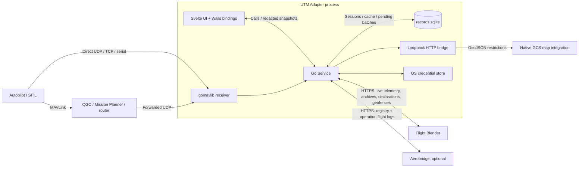
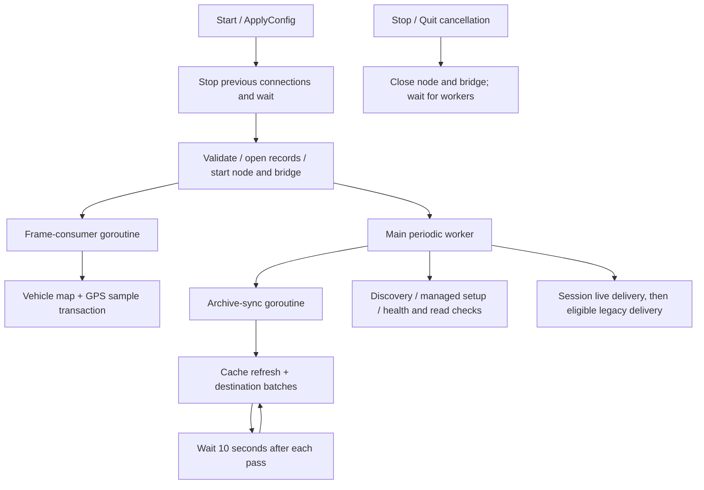
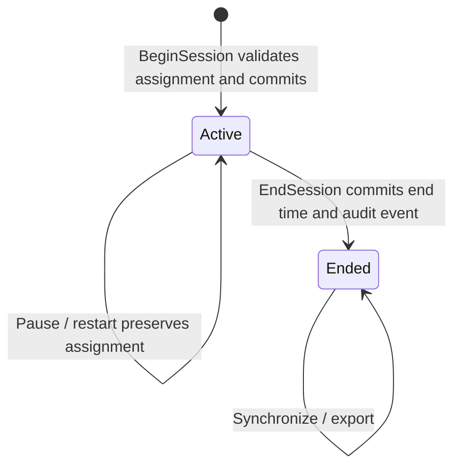
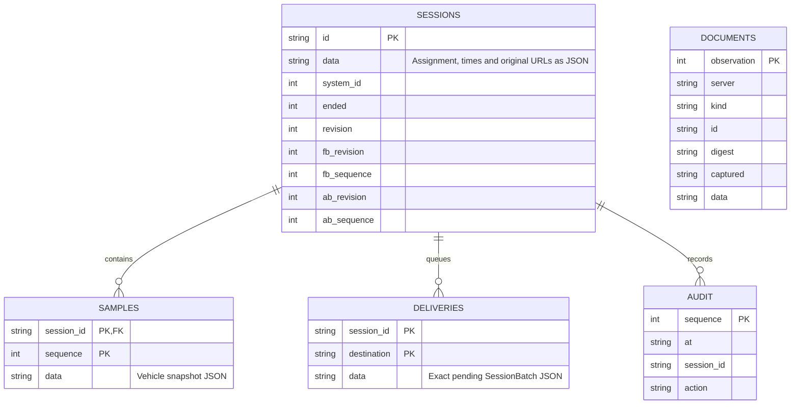
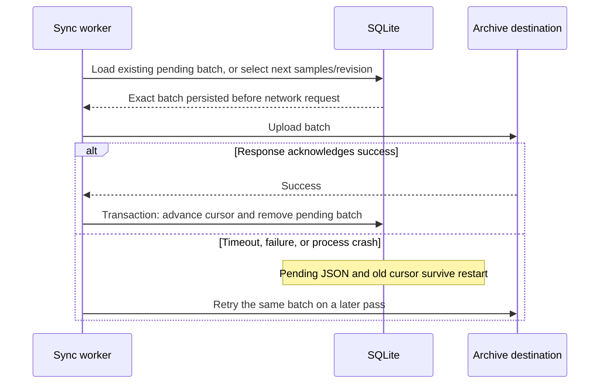

# Architecture and integration contracts

UTM Adapter is a single desktop process built with Go, Wails v3 and Svelte 5. It passively receives MAVLink, maintains live vehicle state, records assigned sessions in SQLite, and connects to Flight Blender and optional Aerobridge APIs. Native GCS integrations consume its local restriction feed. Planning, declaration creation, aircraft control, and flight authorization remain external.

Read [DEVELOPING.md](../DEVELOPING.md) for build/test commands, [CONFIGURATION.md](CONFIGURATION.md) for settings, and [COMPATIBILITY.md](../COMPATIBILITY.md) for evidence and remaining runtime trials. Diagrams below use Mermaid and describe the implemented desktop workflow.

## System context

There is no remote control listener or MAVLink command path. The Wails service supplies desktop RPC, not a public web API. The separate HTTP bridge exposes only health and cached restrictions on a loopback IP. Default ports are UDP `14551` for telemetry and TCP `14552` for bridge HTTP; neither port is a Flight Blender listener.

## Modules and ownership

| Source | Responsibility |
| --- | --- |
| [main.go](../main.go) | Embeds frontend/assets, registers service, creates tray/window, handles single-instance and shutdown lifecycle. |
| [service.go](../internal/adapter/service.go) | Owns config, receiver, live state, worker lifecycle, credentials and redacted snapshots; applies delivery guards. |
| [config.go](../internal/adapter/config.go) | Defaults, validation and atomic, secret-free settings persistence. |
| [records.go](../internal/adapter/records.go) | SQLite schema, assignment validation, transactions, sample sequencing, batches, acknowledgements and document history. |
| [sessions.go](../internal/adapter/sessions.go) | Session service methods, streamed export and orchestration of destination synchronization. |
| [blender.go](../internal/adapter/blender.go) | Flight Blender transport, bearer/OAuth, access checks and live telemetry mapping. |
| [sync.go](../internal/adapter/sync.go) | Declaration caching, archive HTTP requests, Aerobridge registry and flight-log reconciliation. |
| [restrictions.go](../internal/adapter/restrictions.go) | Geofence conversion/cache refresh and local HTTP bridge. |
| [discovery.go](../internal/adapter/discovery.go), [gcsconfigure.go](../internal/adapter/gcsconfigure.go) | Known GCS discovery, conservative forwarding edits, backups and managed Mission Planner source generation. |
| [App.svelte](../frontend/src/App.svelte) | Four screens, forms, session actions, status display; polls snapshots once per second without overlapping polls. |
| [QGC integration](../integrations/qgroundcontrol), [Mission Planner integration](../integrations/mission-planner) | Native restriction rendering; Mission Planner also forwards all connected vehicle links. |
| [build](../build), [scripts](../scripts), [workflows](../.github/workflows) | Native packaging, pinned GCS builds, contract tests and release publication. |

Generated `frontend/bindings/` and `frontend/dist/` derive from service types and frontend sources. Regenerate with Wails build tasks after changing exported Go types; do not maintain a parallel handwritten RPC model.

## Process, concurrency, and lifecycle

The process creates a service, opens the records database independently of telemetry, and starts saved connections on launch. Closing the window hides it; Quit calls `Close`, which stops workers and closes SQLite. A second launch focuses the existing instance, including when a different config path is provided.

`Start` stops the old receiver, validates configuration, starts the bridge and MAVLink node, and resets transient vehicle state/counters. `ApplyConfig` validates and persists settings/credentials before restarting. `Stop` cancels connections and waits for workers; it preserves the database and active assignments. `Close` is the process-shutdown operation, not a session-end operation.

The operation mutex `op` serializes lifecycle mutations, session start/end, export, manual synchronization and plugin removal. `mu` protects shared configuration, snapshot state, vehicle maps and records access points; frame consumption appends samples under this lock. `syncMu` prevents manual/background synchronization passes from overlapping. SQLite uses one connection. Avoid nested database queries while rows hold that connection, and do not hold `mu` across remote HTTP requests.

The main worker uses a one-second ticker; discovery, setup, health and API access checks run approximately every ten iterations. HTTP duration can delay ticks. The archive worker has a 45-second request budget per pass and waits ten seconds afterward. Each HTTP request has its own six-second timeout. These intervals are scheduling choices, not throughput or latency guarantees.

## Telemetry pipeline and live-delivery rules

1. gomavlib decodes ArduPilotMega MAVLink 1/2. Heartbeats and stream requests from the adapter are disabled. UDP expects one frame per datagram; TCP/serial are streams.
2. The frame count includes successfully parsed frames before aircraft filtering. GCS heartbeats and components other than autopilot component `1` are ignored for vehicle tracking; an optional system filter further limits vehicles.
3. `HEARTBEAT` updates armed state and heartbeat receipt time. `GLOBAL_POSITION_INT` updates MSL/relative altitude and provides a display position fallback until the first GPS message.
4. Each `GPS_RAW_INT` updates receipt time and GPS fields, clearing unavailable optional values instead of retaining stale ones. Active sessions append the resulting vehicle snapshot even when it is unsuitable for live delivery.
5. Live delivery requires heartbeat and GPS no older than five seconds, GPS newer than the last successful send, valid coordinates and fix type 3–8, ellipsoid altitude, speed and course. `GPS_RAW_INT` MAVLink 2 extension `alt_ellipsoid` must be nonzero. MSL altitude never substitutes for it.

Latitude/longitude convert from degrees × 10^7, altitude from millimetres to metres, speed from centimetres/second to metres/second, and course from centidegrees to degrees. Unknown speed `65535` and course values outside the valid range remain unavailable. Receipt timestamps use the desktop clock; vehicle boot time is not used as authoritative sample time.

Live payloads contain one observation/current state. Session live delivery uses immutable assignment identifiers. Legacy mode uses configuration identifiers, and an active session suppresses it for the same system even when session delivery is disabled. Both paths send operational status `Undeclared`: armed state alone does not establish airborne state. Accuracy and unavailable vertical-speed/pressure-altitude fields use the receiving API's sentinels in `Blender.Publish`.

Successful live sends advance in-memory sample markers and the accepted counter. Failures retry only while data remains fresh. Restart resets these markers; live delivery is not an exactly-once archive. Historical samples travel exclusively through the durable session API. Parser errors increment a separate count and retain the latest classified diagnostic; subsequent valid frames continue processing, and restart clears the diagnostics.

## Session model and persistence

A session has a random UUID, immutable system/declaration/vehicle/operator/pilot assignment, UTC start/end times, original destination URLs, and a monotonic revision. At most one session can be active per system ID, enforced by a partial unique database index. It can start without a connected aircraft; server existence/authorization checks are separate. Pilot name, licence and contact are required; pilot ID is optional. An Aerobridge operation UUID is required when Aerobridge is enabled at creation.

The database is beside the selected configuration, not named after its filename. It uses `modernc.org/sqlite`, schema `user_version=1`, foreign keys, DELETE journaling, FULL synchronous mode and a five-second busy timeout. New data directories request mode `0700`; the database and reports request `0600`. OS access controls still determine effective protection. Opening a newer schema is rejected. Add explicit migration and upgrade/rollback coverage before evolving this schema.

Only `samples.session_id` has a SQL foreign-key constraint; the diagram's delivery/audit relationships are logical. Documents are associated by server/kind/ID, not by a session FK. Declaration observations retain changes using a SHA-256 digest of raw JSON; formatting changes can therefore count as a new observation. Restriction cache refreshes update freshness even if content is unchanged. The cache is scoped to the configured server URL.

Starting/ending a session and appending a sequenced sample use transactions. Start/end audit events are committed with their session changes. Missing GPS fixes produce samples with unavailable fields rather than invented positions. There is no automatic sample deletion, retention limit, database encryption or cryptographic audit certification.

## Archive synchronization and crash recovery

Flight Blender and Aerobridge have independent acknowledged revision/sequence cursors. Each pass considers all sessions, not just the latest 100 displayed by the UI, and attempts at most one batch of up to 200 samples per destination per session. Metadata-only revisions, including session end, must also be acknowledged. Destination URLs are captured at session creation and compared with current configuration; server changes do not migrate records.

Persisting the exact payload closes the gap between a remote commit and a lost response. Acknowledgement advances cursors transactionally; samples appended during an upload remain pending. Flight Blender's companion API stores sequences idempotently. Its records are owner-isolated by token issuer/subject; retries with a different identity may be rejected even for the same URL.

Aerobridge has no native idempotency key for this operation. The adapter adds `raw_log.adapterBatchKey` built from session ID, revision and last sample sequence (or zero). Before posting it lists operation logs and looks for that key and matching operation. A lost response can then reconcile to the existing log. This relies on read-after-write visibility and one adapter owning the session; concurrent cloned datasets or delayed list visibility can create duplicates. Do not describe this destination as an unconditional exactly-once delivery guarantee.

Cache refresh failures do not delete prior data. Synchronization reports destination errors through status; a completed manual `Synchronize` call does not imply all destinations accepted every batch. Disabled Aerobridge leaves its queue intact, and enabling it later does not retrofit earlier sessions with an Aerobridge destination.

## External API contracts

Paths are relative to configured base URLs. URL construction, pagination, request/response structures and status handling live in the linked clients; coordinate changes with the receiving service.

| Service | Method/path | Purpose |
| --- | --- | --- |
| Flight Blender | `GET /ping` | Unauthenticated reachability. |
| Flight Blender | `GET /flight_declaration_ops/flight_declaration?page_size=1` | Read-access check without a selected declaration. |
| Flight Blender | `GET /flight_declaration_ops/flight_declaration/{UUID}` | Read-access check for a selected declaration. |
| Flight Blender | `GET /flight_declaration_ops/flight_declaration` | Paginated declaration cache, broad start/end date range and page size 100. |
| Flight Blender | `GET /geo_fence_ops/geo_fence` | Geofence cache, limit/offset pagination with limit 100. |
| Flight Blender | `PUT /flight_stream/set_telemetry` | Fresh live position payload. |
| Flight Blender | `PUT /adapter_ops/sessions/{UUID}` | Shared `ArchiveBatch` version 2 containing session metadata and sequenced samples. Requires companion API/migration. |
| Aerobridge | `GET /registry/aircraft/` | Health/read check and aircraft choices. |
| Aerobridge | `GET /registry/pilots/` | Pilot choices. |
| Aerobridge | `GET /gcs/flight-operations` | Operation choices. |
| Aerobridge | `GET /gcs/flight-logs?operation={UUID}` | Existing-log reconciliation. |
| Aerobridge | `POST /gcs/flight-logs` | `{operation, raw_log: {adapterBatchKey, schemaVersion: 1, batch}}`. |

The common HTTP format, completion rules and source mappings are documented in [Shared session archive API](SESSION_ARCHIVE.md). Local and Aerobridge `SessionBatch` JSON is defined by `Session`, `Assignment`, `Pilot`, `Sample` and `Vehicle` in source. Samples have monotonically increasing per-session sequence numbers; optional vehicle values encode absence rather than zero substitutes. Reports have top-level `schemaVersion: 1`, `session`, `declarationHistory`, `samples` and `audit`. GPS rows stream from SQLite during export, so a whole flight need not fit in memory. Export requires an ended session and writes a private temporary file, syncs it, then renames it into `exports/` with a unique filename. Declaration history contains observations captured by this adapter, not a complete authoritative server change log.

All HTTP clients reject redirects and bound response reads (8 MiB for general API responses; 1 MiB for OAuth token decoding). OAuth uses client credentials with HTTP Basic authentication, caches until 30 seconds before expiry, defaults missing expiry to 300 seconds and rejects negative expiry. HTTP 401 invalidates the cached token for the next attempt; it does not immediately replay the failed request. Response bodies are not echoed into user-facing HTTP errors.

Pagination is bounded. Aerobridge accepts array or paginated `results` shapes and reconstructs same-origin page requests rather than following arbitrary `next` URLs. Declaration pagination uses server counts; geofence pagination stops at a short page. If upstream response formats or limits change, update contract tests alongside the client.

## Restriction bridge and native GCS integration

`GET /v1/health` returns local bridge status/version. `GET /v1/restrictions` returns `application/geo+json` with `Cache-Control: no-store`: a FeatureCollection plus `fetchedAt` and `stale`. No cached data produces an empty stale collection; invalid cached data/database errors produce HTTP 503. Data older than two minutes is stale.

Flight Blender `raw_geo_fence` may be an object or JSON string containing a FeatureCollection. Features retain their original properties with restriction ID/name/start/end metadata added. QGC and Mission Planner poll the feed and retain their last boundaries on failure, showing stale state. They render Polygon/MultiPolygon outer rings; holes are filled. These are display integrations, not altitude/time filtering or flight-permission enforcement.

Automatic forwarding edits are conservative: only local UDP, outside direct mode, and only while the relevant GCS is closed. QGC writes its `[General]` forwarding keys and an adjacent managed-target marker, preserving other destinations. Changed files receive timestamped backups. Mission Planner source installation is explicit opt-in and preserves files without the managed marker. Removing the managed source renames it to an unloaded backup; release DLL installation/removal is manual. Turning auto-configuration off does not undo earlier edits.

Custom QGC is built from pinned upstream with a minimal custom layer, preserving the standard application/settings identity. The Mission Planner release DLL is compiled from the same production generator as the installed source, but with default endpoints. Never install source and DLL copies together.

## Security, failure boundaries, and extension rules

Secrets use the OS credential store under `org.openutm.adapter`, keyed by configuration path; snapshots expose only presence flags. Config persistence strips secrets. Removing credentials pauses connections and disables legacy/Aerobridge delivery, but leaves the session-delivery flag unchanged. Records and exports include personal and flight data; protect backups and avoid exposing them in diagnostics.

Loopback HTTP is readable by other local processes. MAVLink reception has no adapter-level remote-sender authentication, and UDP/TCP telemetry is not encrypted by this application. Use trusted interfaces and external transport security where needed. Single-instance behavior prevents two normal desktop launches, but does not provide a distributed lock across copied databases or machines.

When changing the implementation, preserve these invariants:

- Pause/reconfigure/shutdown must not end sessions or delete pending work.
- Sample sequencing, revision changes, audit events and acknowledgements must retain their transaction boundaries.
- Pending retries must reuse the exact persisted payload; live freshness markers must stay separate from archive cursors.
- Server/identity binding must not silently redirect historical records.
- Unknown telemetry must remain unavailable; MSL must not become ellipsoid altitude.
- GCS setup must preserve unmanaged targets/plugins and never introduce vehicle commands.
- Export/API/schema changes must be versioned and tested against the real receiving application as well as fixtures.

Verification is layered: focused Go tests for conversion/configuration/authentication, SQLite restart/cursor/export tests, real-UDP multi-aircraft integration with outages, optional actual Flight Blender contract tests, native Qt map tests, packaged GCS boot/fetch tests, and Windows DLL load/init/unload tests. See the [developer test matrix](../DEVELOPING.md#verification-matrix). Hardware and connected GCS trials remain separate from those checks.
